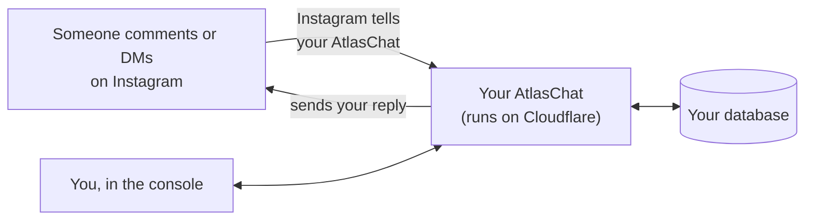

# AtlasChat

**Instagram DM automation for @rayen.mhz.** Someone comments a keyword on a Reel, and they get a DM with the link. Story replies, DM keywords, a visual flow builder, a live inbox and your numbers are included.

AtlasChat is Rayen Mehrez's copy of [FewChat](https://github.com/jasonc00person/fewchat) (MIT, Copyright 2026 Jason Cooperson). It runs on your own Cloudflare account through Instagram's official API. Contacts and conversations sit in your own database. There is no per-contact pricing.

This folder is already aimed at **@rayen.mhz**, the business **Atlas AI**, the site **rayenmehrez.me**, and the community name **Atlas AI Academy**. The Worker, database and queue are named `atlas-chat` and `atlas-chat-send`. The contact email, the Meta app, the DM link, and every token are still blank.

**You don't need to know how to code.** One command sets it up and tells you what to click.


<sub>Screenshots are the upstream console with made-up sample data. This fork's console is named AtlasChat and uses forest green (#1A3C34). Open it on your own computer with `npm run preview`.</sub>

## What it does

- **Comment-to-DM.** Someone comments your keyword on a post or reel and gets your DM, plus an optional public reply under their comment. Works on one post, every post, or the next one you publish.
- **Story and DM automations.** Trigger on a reply to your story, a story mention, a keyword in a DM, or someone's first message.
- **A visual flow builder.** Messages with buttons and quick replies, delays, conditions, A/B splits and tags, drawn as cards on a canvas. Drafts save themselves; Publish makes them live.
- **Inbox.** Every conversation live in one place, with photos, voice notes and reactions. Reply by hand any time.
- **Contacts and tags.** Everyone who messaged or commented, searchable.
- **Metrics.** Messages, people reached, reply rate, click-through rate and your top automations.
- **Reliable sending.** Messages queue under Instagram's hourly limit and retry, missed comments are picked up, and your phone can get an alert if something keeps failing.
- **AI replies (beta, optional).** An assistant that answers DMs in your voice. Off by default. Everything above works without it.

| Your automations | One automation, with its numbers |
| --- | --- |
|  |  |


## What you need

| | Cost | Notes |
| --- | --- | --- |
| An Instagram **professional** account | Free | Business or Creator. Switch in the Instagram app: Settings → Account type and tools. |
| A Facebook account | Free | Used once, to register your own app with Meta. Instagram requires that for any DM tool. |
| A Cloudflare account | Free | This is where AtlasChat runs. Setup creates it with you. Workers Paid is $5 a month and is not required to deploy. Caps are in [docs/HOW-IT-WORKS.md](docs/HOW-IT-WORKS.md). |
| A computer with Node.js 22+ | Free | Mac, Windows or Linux. Get it from [nodejs.org](https://nodejs.org) (the big "LTS" button). |

Set aside about 45 minutes. Most of it is clicking through Meta's developer site, and setup gives you a page with every click and your own values filled in.

## Set it up

### 1. Get the code

Open a terminal. On a Mac that's the **Terminal** app; on Windows, **PowerShell**. Then paste:

```bash
git clone https://github.com/rayenmehrez/atlas-chat.git
```

```bash
cd atlas-chat
```

No `git`? Install it from [git-scm.com](https://git-scm.com) and run the two lines again. (The green **Code** button → **Download ZIP** also works, but `npm run update` needs git to fetch new versions.)

### 2. Run setup

**The easiest way** is with [Claude Code](https://claude.com/claude-code). Start it in the folder and say what you want:

```bash
claude
```

Then type **set this up**. Claude runs everything, explains each step in plain words, and walks you through the parts that need your hands.

**Or run it yourself.** The Instagram account, business, website and community name are already filled in. It still needs a contact email you are fine publishing, and later the Meta app values:

```bash
npm run setup -- --email=you@example.com
```

Add `--link=https://...` for the link your DMs send. Until then that link stays a placeholder.

Either way, you can stop at any point. Run it again and it continues where it left off.

### What setup does, and what you do

| Setup does this for you | You do this |
| --- | --- |
| Installs AtlasChat's tools | Give a contact email you are fine publishing on the privacy page |
| Creates your database and message queue on Cloudflare | Click **Allow** when Cloudflare opens in your browser |
| Builds every database table | |
| Makes your passwords and stores them safely | |
| Puts AtlasChat live on your own address | |
| Writes **MY-SETUP.md**: your console address and password, and every Meta click with your values filled in | Follow its 9 steps on Meta's site (about 15 minutes), then paste two values back |
| Checks that Instagram can reach your AtlasChat | Click **Log in with Instagram**, or put a long-lived token in `.env` as `IG_ACCESS_TOKEN` (see `.env.example`) |
| Waits for your first test message to arrive | Send your account a DM from another account |

### 3. Check it

```bash
npm run check
```

It looks at your live setup and tells you, in plain words, what works and what to fix.

## Your first automation

1. Open your console (the address is in `MY-SETUP.md`) and click **Automation** → **New Automation**.
2. Pick the template **Reel comment → resource link** (or **Comment keyword → DM link**). Pick the Reel and type a keyword such as `LINK`. The public reply is already filled in. Put your real link on the button, or set it once in Settings. The button uses `{{SKOOL_LINK}}`.
3. Click the message card and write the DM. Put your link on its button.
4. Click **Test**. It gives you a 3-digit code: DM that code to your account from another account to see the whole flow, as often as you want.
5. Click **Publish**. From now on, everyone who comments the keyword gets the DM.

## How it works, in plain words



- **Instagram tells your AtlasChat** the moment someone comments or messages. That notification is called a *webhook*.
- **Your AtlasChat** is a small program running on Cloudflare (they call it a *Worker*). It's always on. Your computer can be off.
- It looks for an automation that matches, and **sends your reply** through Instagram's official API.
- Everything is saved in **your database**, also on your Cloudflare account.
- **The console** is the website where you build automations, read your inbox and see your numbers.

The longer tour, with a glossary: [docs/HOW-IT-WORKS.md](docs/HOW-IT-WORKS.md).

## Everyday commands

Run these in the `atlas-chat` folder.

| Command | What it does |
| --- | --- |
| `npm run check` | Is everything working? Says what's wrong and how to fix it. |
| `npm run update` | Gets the newest AtlasChat and puts it live. Your settings are never touched. |
| `npm run setup` | Run it again after changing a setting or adding a key. It's always safe. |
| `npm run preview` | Opens a practice console on your own computer with made-up sample data. Nothing is sent. |

## Where your stuff lives

These files are yours. Git ignores them, so updates never overwrite them and they're never uploaded by accident.

| File | What's in it |
| --- | --- |
| `fewchat.config.json` | Your answers: Instagram username, business name, your link |
| `.env` | Your passwords and keys. Never share it. |
| `MY-SETUP.md` | Your console address, your password and your Meta steps. Never share it. |
| `src/prompt.ts`, `src/knowledge.ts` | The AI's script, if you turn the AI on |

## Questions

**Do I need to code?** No. Setup is one command, and automations are built by clicking in the console.

**What does it cost?** AtlasChat is free to deploy on Cloudflare's free plan. Queues, D1, cron, Workers AI and the SQLite Durable Object are included, with daily caps. Workers Paid is $5 a month and is optional. The details are in [docs/HOW-IT-WORKS.md](docs/HOW-IT-WORKS.md). Optional AI replies cost a few cents per conversation, paid to Anthropic.

**Is this allowed by Instagram?** It uses only Instagram's official API, the same one other DM tools use, and follows its rules by design (see below). Staying inside them is still your responsibility.

**Where is my data?** In a database on your own Cloudflare account. Nobody else can see it, including the people who wrote AtlasChat.

**Can it run more than one Instagram account?** One account per install. For a second account, set it up again in a second folder with `npm run setup -- --name=atlas-chat-two`.

**Can it DM my new followers?** No. Instagram doesn't tell outside apps when someone follows you.

**Something isn't working.** Run `npm run check`, then see [docs/TROUBLESHOOTING.md](docs/TROUBLESHOOTING.md).

## AI replies (beta)

An optional assistant can answer DMs in your voice with Claude, from a script and facts you write. It's off by default, it can't be switched on until its script is written, and it's still a work in progress. How to turn it on: [docs/AI.md](docs/AI.md).

## Instagram's rules

- Automated messages only go out within 24 hours of the person's last message, comment or button tap. You can always reply by hand from the Instagram app.
- For an account you own, Meta's standard access is enough. You don't need App Review, but your Meta app has to be switched to **Live**.
- Buttons and quick replies show in the Instagram phone app, not on desktop.
- Some places require telling people a bot is replying. If you turn on AI replies, set `DISCLOSE` in `src/autonomy.ts` where that applies to you.
- Photos, voice notes and videos are fetched when you look at them and never stored, in line with Meta's Platform Terms.

## For developers

```bash
npm test            # the full suite, with real SQL through a local D1 shim
npm run typecheck
npm run deploy      # refuses while setup isn't finished
npx wrangler tail   # live logs
node scripts/fc.mjs # manage automations from the terminal (list, copy to your next post, publish, on/off, stats)
```

`wrangler.jsonc` and `src/brand.ts` are built from `templates/` and `fewchat.config.json` by `npm run setup` (and on `npm install`), and are git-ignored, as are `src/prompt.ts` and `src/knowledge.ts`. Forking to keep your own version in git? Delete those lines from `.gitignore`. [CLAUDE.md](CLAUDE.md) explains how the code is laid out.

Issues and pull requests are welcome. When you report a problem, include what `npm run check` prints. Never post your `.env` or `MY-SETUP.md`.

## License and trademarks

[MIT](LICENSE). Copyright (c) 2026 Jason Cooperson. This fork keeps that notice. Upstream: [FewChat](https://github.com/jasonc00person/fewchat).

AtlasChat is an independent project. It is not affiliated with, endorsed by or sponsored by Manychat, Meta, Instagram, Cloudflare, Anthropic or Skool. Their names are trademarks of their owners and are used here only to say what AtlasChat works with or is an alternative to.
